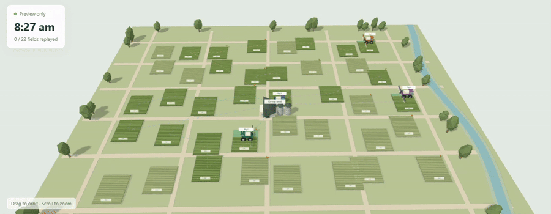
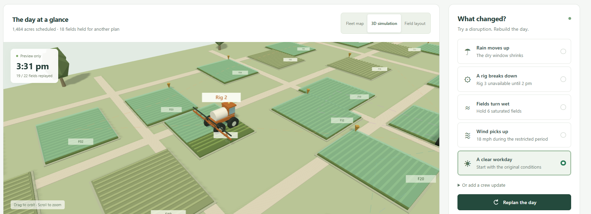
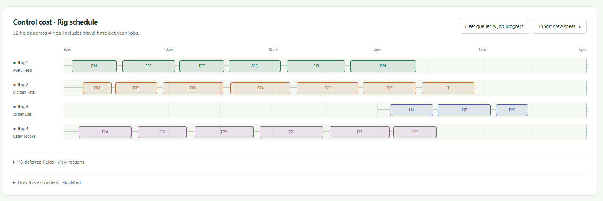
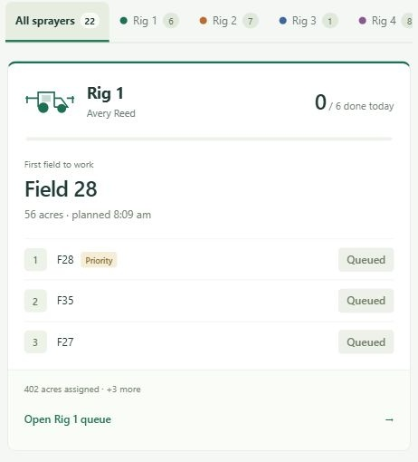
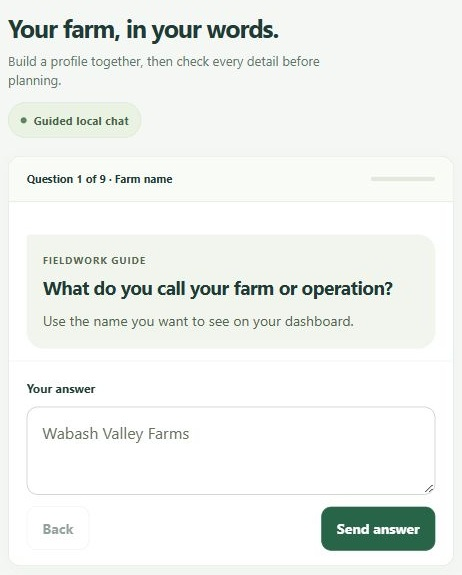
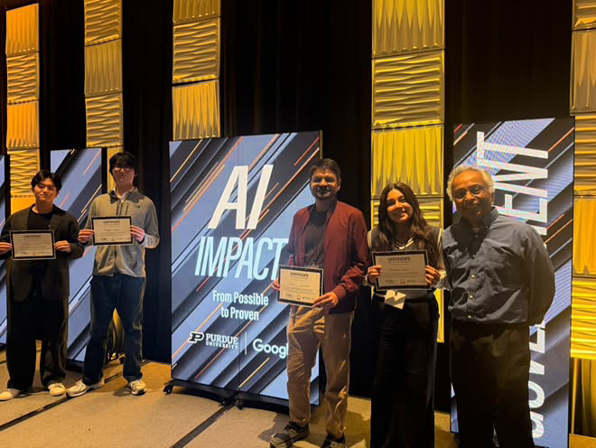

# Fieldwork

## An integrated system for optimizing spraying operations

Plan the workday. Coordinate your fleet. Adapt when conditions change.

Fieldwork brings scheduling, fleet coordination and cost visibility into one workspace for agricultural spraying teams—helping managers make better use of equipment, protect productive hours and respond to disruptions with a clear plan.



## Features at a glance

<table>
  <tr>
    <td colspan="2" valign="top">
      <h3>Track &amp; replan the day</h3>
      <p>Preview simulated field activity and replan when rain, equipment availability, wet fields or wind change the day.</p>
      
    </td>
  </tr>
  <tr>
    <td colspan="2" valign="top">
      <h3>Rig schedule</h3>
      <p>See each rig’s field sequence across the workday, including operator assignments and travel time between jobs.</p>
      
    </td>
  </tr>
  <tr>
    <td width="50%" valign="top">
      <h3>Fleet &amp; field queues</h3>
      <p>Switch between sprayers to see the assigned operator, first field, priority flags and ordered jobs. Manual job tracking becomes available after approval.</p>
      
    </td>
    <td width="50%" valign="top">
      <h3>Guided farm setup</h3>
      <p>Describe your operation through nine guided steps, then review the profile before using it for planning.</p>
      
    </td>
  </tr>
</table>

## Features & business benefits

- **Plan ahead around field conditions.** Build schedules around rain timing, wind limits, dry-time requirements and field holds. Live weather forecasting and local soil-data integrations are planned; the current demo uses simulated conditions.
- **Keep costs and productivity visible.** Compare estimated operating costs, scheduled acres, labor hours and travel time alongside manually recorded job progress.
- **Manage disruptions efficiently.** Report breakdowns, wet fields, rain changes or wind restrictions; review alternative schedules and approve a revised plan.
- **Coordinate the fleet.** Give each sprayer a clear field queue, assigned operator and planned work times, with controls to start, complete or hold jobs.
- **Account for equipment downtime.** Replan around reported rig unavailability. Preventive maintenance scheduling and service-history tracking are planned extensions.
- **Simplify customer onboarding.** Capture the operation’s fields, equipment, crew, working hours and priorities through guided farm setup, then review and export the profile.
- **Improve operating efficiency.** Compare work sequences and travel requirements to identify opportunities to use available crew and equipment more effectively.
- **Reduce the impact of disruptions.** Keep unresolved reports visible and carry their restrictions into subsequent planning runs.
- **Identify cost-saving opportunities.** Compare lower-cost plans against acreage and rain-buffer trade-offs before committing resources; savings depend on actual operating conditions.
- **Keep managers in control.** Review proposed actions before approval and export fleet queues and job progress as CSV.
- **Start with existing equipment.** Run the app in a browser without adding sensors, gateways or sprayer hardware.

**Current edition:** A local planning prototype with synthetic demo data, simulated fleet positions and browser-saved records. Cost figures are estimates; progress is entered manually. It does not provide live telemetry, dispatch equipment or replace verified operational spray guidance.

## Local deployment

Requires **Python 3.12**. From the repository folder:

**Windows (PowerShell)**

```powershell
py -3.12 -m venv .venv
.venv\Scripts\python.exe -m pip install -r requirements.txt
.venv\Scripts\python.exe -m backend.server
```

**macOS / Linux**

```sh
python3.12 -m venv .venv
.venv/bin/python -m pip install -r requirements.txt
.venv/bin/python -m backend.server
```

- Open **[http://127.0.0.1:8765](http://127.0.0.1:8765)** and keep the server running while using the app.
- For an existing installation, run only the final command to restart the server.
- No API key or external service account is required.
- For a no-install preview, open [the portable browser replay](output/Fieldwork.html). It uses recorded plans; new optimization requires the local server.

## Recognition & team

**Winner — Most Impactful Idea**, Innovation Sprint challenge at the **Purdue + Google AI Summit 2026**.

The [3rd Annual Purdue + Google AI Summit](https://www.purdue.edu/events/ai-summit/), organized by Purdue’s Institute for Physical AI, took place October 29–30, 2026, with a focus on translating AI into real-world impact.



*Celebrating the Most Impactful Idea award at the Purdue + Google AI Summit 2026.*

Built by:

- Maninder Kaur
- Zhiye Liu
- Mingyu Kang
- Bilal Ahmed
